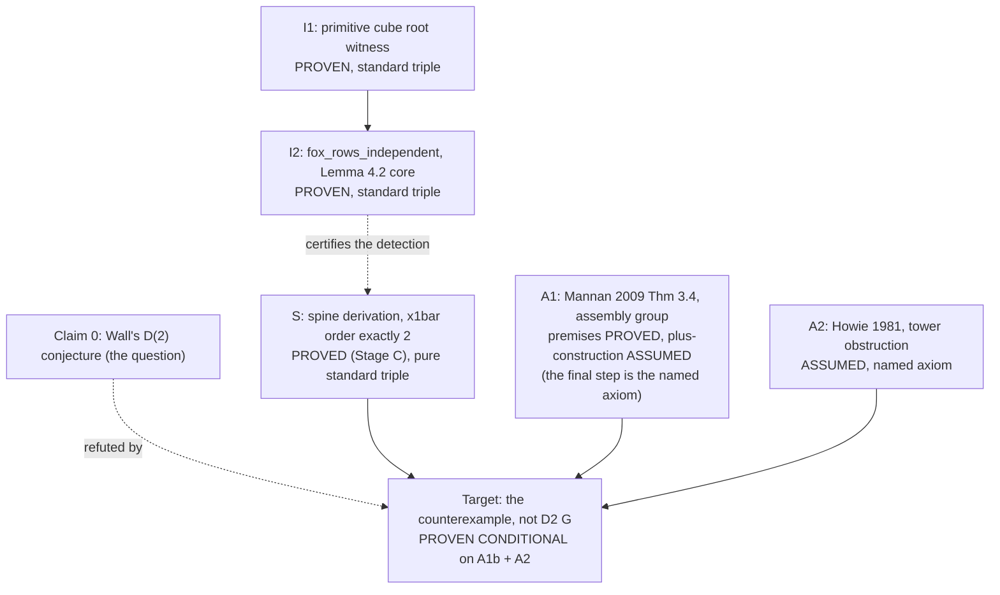
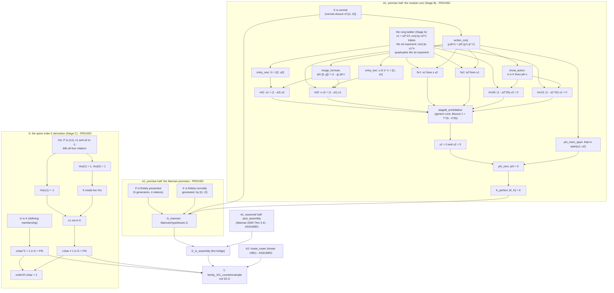

# WallD2: a conditional Lean formalization of a counterexample to Wall's D(2) problem

This package formalizes the computational spine of the preprint
"A Counterexample to Wall's D(2) Problem" (OpenAI math dump, family 321,
October 6, 2026) and composes it with the paper's classical literature
inputs, which are stated as explicit named axioms.

The Mannan literature input enters in two layers: the group-level
premise shape `MannanHypotheses` (proved in this package for family
321, see Honesty below) and the named topological axiom
`plus_assembly` (Mannan's finite plus construction).

## Contents

The argument is organized as shown in the coarse DAG below: six
claims - the witness I1, the Fox independence I2, the order-2 spine
S, the assembly import A1, the tower obstruction A2, and the target
T (the counterexample). Three are proved outright; A1 splits into a
premise half (proved) and a topological half (the named axiom
`plus_assembly`); A2 is the named axiom `howie_tower`. The package
carries the full chain: every algebraic layer named below is
kernel-proved here; the only assumptions anywhere are those two
named topological axioms (plus the atom their types mention).

- `WallD2/Lemma41Defs.lean`, `WallD2/Lemma41.lean` (Stage A): the
  family-321 presentation (five generators x1, a1, x2, a2, s; four
  relators r1..r4) and the word-algebra ladder - x1 = a2^13,
  conjugation by x2^n triples the a2-exponent, conjugation by x1^n
  quadruples the a1-exponent, t1 = a2^26, s t2 s^-1 = a1^15, and the
  commutativity facts - through the two entry identities
  t1 = [t2, a2] and s t2 s^-1 = [t1, a1].
- `WallD2/Lemma41StageB.lean` (Stage B): **the paper's Lemma 4.1,
  K is perfect, proved** (519 lines, standard triple): the
  abelianization Kab of K as a module over the group ring ZP, the
  identification of the action with conjugation (discharged into a
  kernel-proved construction), the image formula
  phi ([t, g]) = (1 - g) phi t, the relation pair
  u1 = (1 - a2) u2 and s u2 = (1 - a1) u1, the annihilation core
  (geometric-sum telescoping plus the Bezout identity
  1 = 7*15 - 4*26 forcing u1 = 0 and u2 = 0), and phi = 0:
  the abelianization of K is trivial, so [K, K] = K.
- `WallD2/Lemma41StageC.lean` (Stage C): **S, the order-2 spine**
  (coarse-claim S in the DAG below):
  the sign character rho (x1, a2 to -1; a1, x2, s to 1) kills all
  four relators, so it descends to P; K lies in ker rho; x1 is not
  in K; x1bar in G = P/K has order exactly 2. The spine's own
  certification - see the DAGs section for how this relates to
  Lemma 4.2 (the sign character is self-contained; Fox row
  independence is the separate certification of the detecting
  character, a leaf off the path to the target).
- `WallD2/Lemma41Mannan.lean`: **the A1 premise half - the Mannan
  premises** (A1a in the DAG below): P
  finitely presented, K normal, K perfect (Stage B), K finitely
  normally generated ({t1, t2}), G = P/K definitionally -
  MannanHypotheses discharged for the spine group, pure standard
  triple.
- `WallD2/Lemma41Assembly.lean`: **closing A1's premise half and
  reaching T**: G_is_assembly (the proved premises + plus_assembly
  give the assembly conclusion, A1's payoff) and
  family_321_counterexample (the tower + the spine facts derive T),
  assuming exactly the topological axioms and nothing algebraic.
- `WallD2/Family321Spine.lean`: the reader's front door - the
  spine S, the Mannan premises, the assembly conclusion, and the
  counterexample T restated with one-line proofs delegating to the
  chain, plus the receipt summary.
- `WallD2/WallD2.lean`: the single self-contained Lean file (Mathlib-based):
  - `WallD2.exists_primitive_cube_root`: non-vacuity witness (unconditional).
  - `WallD2.fox_rows_independent`: Lemma 4.2's core (unconditional): the
    4x5 Fox derivative matrix at the character rho has linearly independent
    rows over the complex numbers, for every primitive cube root zeta.
  - `WallD2.MannanHypotheses`: the A1 premise shape (a definition,
    not an axiom): Q arises as the quotient of a finitely presented
    group by a normal, perfect, finitely normally generated
    subgroup.
  - `WallD2.plus_assembly`: the A1 topological half, the literature
    axiom (Mannan 2009 Thm 3.4, the finite plus construction): from
    the premises, the assembled finite D(2)-testbed complex exists,
    so Q is an assembly group.
  - `WallD2.IsAssemblyGroup`, `WallD2.howie_tower`: the assembly-group atom
    (kept as the premise language of the tower) and the Howie tower
    obstruction. NOT proved in this file; see Honesty below.
  - `WallD2.wall_d2_counterexample_end_to_end`: the conditional theorem:
    an assembly group containing an element of order exactly 2 fails the
    D(2) property.

## Build

Requires Lean 4 + Mathlib (tested on the mathlib4 v4.33.0 line):

```
lake exe cache get   # fetch the prebuilt mathlib oleans
lake build WallD2.WallD2 WallD2.Family321Spine
```

## Honesty: what is proved and what is assumed

`#print axioms` receipts:

```
'wall_d2_counterexample_end_to_end' depends on axioms: [IsAssemblyGroup, howie_tower, propext]
'fox_rows_independent' depends on axioms: [propext, Classical.choice, Quot.sound]
'MannanHypotheses' depends on axioms: [propext, Classical.choice, Quot.sound]
'Lemma41Spine.x1bar_order' depends on axioms: [propext, Classical.choice, Quot.sound]
'Lemma41Spine.G_mannan' depends on axioms: [propext, Classical.choice, Quot.sound]
'Lemma41.K_perfect' depends on axioms: [propext, Classical.choice, Quot.sound]
'Lemma41Spine.family_321_counterexample_spine' depends on axioms: [IsAssemblyGroup, howie_tower, plus_assembly, propext, Classical.choice, Quot.sound]
```

(All of these are live-checked from this package's own build.)

The concrete instantiation composes the layers IN THIS PACKAGE
(`Lemma41.family_321_counterexample` in `WallD2/Lemma41Assembly.lean`):

```
'Lemma41.family_321_counterexample' depends on axioms: [WallD2.IsAssemblyGroup,
 WallD2.howie_tower, WallD2.plus_assembly, propext,
 Classical.choice, Quot.sound]
```

That receipt is the payoff of the two-layer split: every algebraic
premise of the assembly theorem is kernel-proved here
(`Lemma41.G_mannan` discharges `MannanHypotheses` for the family-321
spine: P finitely presented, K normal, perfect, finitely normally
generated, G = P/K, with K perfect proved in `Lemma41StageB`), and the
assumed surface of the concrete counterexample is exactly the
topological layer.

- `propext`, `Classical.choice`, `Quot.sound` are Lean/Mathlib's three
  standard foundation axioms.
- The named literature imports:
  - `plus_assembly` (A1b): Mannan, "Quillen's plus construction and the
    D(2) problem", Alg. Geom. Topol. 9 (2009) 1399-1411, Theorem 3.4
    (the finite plus construction; the paper's Proposition 3.1).
  - `howie_tower` (A2): Howie, "On pairs of 2-complexes and systems of
    equations over groups", J. reine angew. Math. 324 (1981) 165-174
    (cyclic tower obstruction), in the formulation used by the
    preprint's Theorem 2.2.
  - `IsAssemblyGroup`: the atom their types mention, kept as the premise
    language of the tower so the end-to-end composition is unchanged.
- What is UNCONDITIONAL here: `fox_rows_independent`, the witness,
  `Lemma41StageB.K_perfect` (the paper's Lemma 4.1), the order-2 spine
  (`Lemma41StageC`), and the Mannan premises (`Lemma41Mannan.G_mannan`)
  - all sorry-free, no axioms beyond Lean's standard three.
- What is proved IN THIS PACKAGE (since 2026-10-14, the full chain):
  the order-2 spine (Lemma41StageC), the perfectness of K - the
  paper's Lemma 4.1 (Lemma41StageB), the Mannan premises
  (Lemma41Mannan), the bridge and the concrete counterexample
  (Lemma41Assembly), and the abstract spine + axiom layer
  (WallD2.lean). The concrete counterexample's receipt carries
  NO algebraic premises at all: exactly the two topological axioms
  plus the standard triple.
- What is NOT here at all: the topological constructions themselves
  (the plus construction building the finite complex X, the tower
  argument), and the local-coefficient cohomology machinery. Mathlib
  v4.33.0 carries none of that; those layers are the named axioms above.

## The two DAGs, the node table, and the proof outline

The formalization is read at two grains, both drawn below. The **coarse
DAG** is the claim grain - the six claims (I1, I2, S, A1, A2, T)
of the paper's architecture, each with its proof status attached. The **fine DAG** is the theorem grain - the
proof scripts node for node, every edge a proof-script dependency the
Lean kernel recorded. A **node table** maps each fine node to the
natural-language claim it belongs to, the bilingual dictionary between
proof-script names and prose; the **proof outline** writes the story
back out of the machine structure in natural language, section by
section, premise before consumer. The four artifacts together let a
reader check the formalization's shape against the paper's argument
without reading a line of Lean.

### The coarse DAG (the six claims)



Six claims, honestly labeled: three proved in Lean with the pure
standard triple (I1, I2, S), two literature imports (A1, A2) of which
the final steps are named axioms while every algebraic premise
underneath is kernel-proved in this package, and the target, proven
conditional on the two assumed topological steps. The dotted I2-to-S
edge records the paper's mathematical relationship (Lemma 4.2's
detection feeds the order-2 conclusion through twisted cohomology);
in the formalization the sign character of Stage C proves the order-2
fact self-contained, so at the fine grain I2 does not feed S - it is
the separate certification of the detecting character, a leaf off the
kernel path to T.

### The fine DAG (the proof scripts, node for node)

Every proved node below carries the standard triple receipt; the
assumed nodes are marked. The letters are stage names, not new claims:
coarse S = the S subgraph; coarse A1 = the two premise subgraphs plus
the assumed node plus_assembly plus the bridge G_is_assembly; coarse
A2 = the assumed node howie_tower; coarse T = family_321_counterexample.



### The node table (fine nodes to natural-language claims)

|Layer|Node|Natural-language claim|Receipt|
|---|---|---|---|
|A (inside A1's premise half)|R1L|the eight rungs: x1 = a2^13; conjugation by x2^n sends a2^m to a2^(3^n m); conjugation by x1^n sends a1^m to a1^(4^n m); t1 = a2^26; s t2 s^-1 = a1^15; t1 commutes with a2; s t2 s^-1 commutes with a1|standard triple|
|A|E1, E2|t1 = x1^2 equals the commutator [t2, a2]; s t2 s^-1 equals [t1, a1] (the two entry identities)|standard triple|
|B (inside A1's premise half)|KN|K, the normal closure of {t1, t2}, is a normal subgroup (with the defining memberships t1 in K, t2 in K)|standard triple|
|B|AC|the ZP-action of a group element on Kab (the abelianization of K) is conjugation, g phi k = phi (g k g^-1); kernel-proved since the 2026-10-13 discharge of the identification pair|standard triple|
|B|IF|the image of a commutator word is the scalar action, phi ([t, g]) = (1 - g) phi t|standard triple|
|B|TA|an element of K acts trivially on Kab, k phi x = phi x (inner conjugation dies in the abelianization)|standard triple|
|B|REL1, REL2|u1 = (1 - a2) u2 (t1 = [t2, a2] dies in the module); s u2 = (1 - a1) u1 (from s t2 s^-1 = [t1, a1])|standard triple|
|B|FIX1, FIX2|a2 fixes u1; a1 fixes s u2 (commutativity-in-P facts from the rung ladder, transported through the conjugation action)|standard triple|
|B|T26, T15|(1 - a2^26) u2 = 0; (1 - a1^15) u1 = 0 (t1 = a2^26 and s t2 s^-1 = a1^15 lie in K, which acts trivially)|standard triple|
|B|ANN, APP|from rel1, rel2, fix1, fix2, triv26, triv15 and the unit s^-1: geometric-sum telescoping plus the Bezout relation 1 = 7*15 - 4*26 force u1 = 0 and u2 = 0 (the generic core: module-abstract, would reprove for any presentation with the same shape)|standard triple|
|B|SPAN, PZ|every element of Kab is a ZP-combination of u1, u2 (closure induction: conjugates act through the module); with u1 = u2 = 0 the span collapses, phi = 0|standard triple|
|B|KP|phi = 0 means the abelianization of K is trivial, so [K, K] = K: K is perfect|standard triple|
|C (inside S)|RH|the sign character on P (x1, a2 to -1; a1, x2, s to 1) is well-defined: it kills all four relators (a decide check on each)|standard triple|
|C|RX1, RT|rho(x1) = -1; rho(t1) = rho(t2) = 1|standard triple|
|C|KL|K lies inside ker rho (the normal closure of {t1, t2}: t1, t2 die under rho, and ker rho is normal)|standard triple|
|C|OUT|x1 is not in K (if it were, rho(x1) would be 1; but rho(x1) = -1)|standard triple (from KL + RX1)|
|C|T1M|t1 in K: the defining membership (t1 is a normal-closure generator)|standard triple|
|C|SQ|x1bar^2 = 1 in G = P/K (x1^2 = t1 lies in K)|standard triple|
|C|NE|x1bar is not 1 in G = P/K (x1 is outside K)|standard triple|
|C|ORD|orderOf x1bar = 2 (from SQ + NE)|standard triple|
|M (inside A1's premise half)|FP, FG|P is finitely presented (five generators, four relators); K is finitely normally generated (witness {t1, t2})|standard triple|
|M|M|P is finitely presented, K is normal, perfect (Stage B), and finitely normally generated, and G is P/K definitionally: every algebraic premise of Mannan's theorem holds for family 321|standard triple|
|assumed|A1B|plus_assembly: Mannan's finite plus construction (from the Mannan premises, the assembled complex exists, so G is an assembly group)|the named axiom|
|assumed|A2N|howie_tower: an assembly group satisfying D(2) has no element of order exactly 2|the named axiom|
|bridge|BR|G_is_assembly: the proved premises + plus_assembly give IsAssemblyGroup G|triple + plus_assembly + atom|
|target|T|family_321_counterexample: with G_is_assembly, the order-2 facts x1bar_sq and x1bar_ne_one, and howie_tower, no D(2) predicate holds for G|exactly the 6-set: triple + the two axioms + the atom|

Two structural facts the fine DAG makes visible:

1. **The assumed nodes sit at the very top, over proved sub-DAGs.**
   plus_assembly and howie_tower are assumed, but everything
   plus_assembly consumes (the whole Stage B annihilation plus the
   finiteness layer) is proved in this package. The only unproved
   nodes in the entire graph are the two assumed ones.
2. **T's own parents are the spine facts, not the summary node.** The
   proof term cites x1bar_sq and x1bar_ne_one directly, so the fine DAG
   draws both as direct parents of T, while orderOf (the combined fact)
   feeds nothing downstream - it is the summary node recording the
   combined order fact (S at the coarse grain).

### The proof outline (the story written back out)

With no argument to test, the machine structure itself writes the
proof outline a mathematician drafts from: sections ordered
outermost-first (the assembly section contains the perfectness
section contains the arithmetic section, exactly how a proof presents
outer claims then fills them in), within-section order
premise-before-consumer (the reading order of a written proof, read
off the kernel-checked dependencies), prose from the node table
above. The outline for this package, top to bottom:

- **The target**: with G_is_assembly, the order-2 facts, and
  howie_tower, no D(2) predicate holds for G.
- **G_is_assembly** (the bridge): the proved premises plus
  plus_assembly give IsAssemblyGroup G.
- **G_mannan**: P finitely presented; K normal, perfect, finitely
  normally generated ({t1, t2}); G = P/K definitionally.
- **K_perfect** (the module core, in reading order): the entry
  identities t1 = [t2, a2] and s t2 s^-1 = [t1, a1]; the
  conjugation action on Kab (g phi k = phi (g k g^-1)); the image
  formula phi ([t, g]) = (1 - g) phi t; the trivial action of K;
  the relations u1 = (1 - a2) u2 and s u2 = (1 - a1) u1; the
  annihilation (triv26, triv15, fix1, fix2, and the Bezout identity
  1 = 7*15 - 4*26 forcing u1 = u2 = 0); the span (every element of
  Kab is a ZP-combination of u1, u2); phi = 0; K perfect.
- **x1bar_ne_one and the sign layer** (S): the sign character kills
  every relator; K lies in ker rho; x1 is not in K; x1bar is not 1;
  x1bar^2 = 1; the order is exactly 2.
- **Assumed imports, not proved here**: plus_assembly (Mannan 2009
  Thm 3.4, the finite plus construction); the IsAssemblyGroup atom;
  howie_tower (Howie 1981, the cyclic-tower obstruction).

A mathematician drafting the paper reads the outline top to bottom,
expands the claims into prose, and cites the formalization as the
machine-checked backing - the formalization itself stays out of the
paper, exactly as a computation's source code stays out of the theorem
statement.

The full generated outline, verbatim:

```
# Natural-language proof outline
# root: Lemma41.family_321_counterexample (89 claims in spec, 28 dominator boxes)

## The target
the target: with G_is_assembly, the order-2 facts x1bar_sq and x1bar_ne_one, and howie_tower, no D(2) predicate holds for G.

## Lemma41.G_is_assembly
Load-bearing step (theorem):
- G_is_assembly (the bridge): the proved premises plus plus_assembly give IsAssemblyGroup G.
Supporting steps in reading order:
- MannanHypotheses G holds: P finitely presented, K normal and perfect, K finitely normally generated, G = P/K definitionally.
- plus_assembly (A1b, assumed, Mannan 2009 Thm 3.4): from the Mannan premises, the assembled finite complex exists, so G is an assembly group.

## Lemma41.G_mannan
Load-bearing step (theorem):
- MannanHypotheses G holds: P finitely presented, K normal and perfect, K finitely normally generated, G = P/K definitionally.
Supporting steps in reading order:
- K is finitely normally generated, by {t1, t2}.
- [K, K] = K: K is perfect (phi = 0 means the abelianization is trivial).
- P is finitely presented (five generators, four relators).
- decidable equality on the generator type (machine bookkeeping for the decide checks).

## Lemma41.K_perfect
Load-bearing step (theorem):
- [K, K] = K: K is perfect (phi = 0 means the abelianization is trivial).
Supporting steps in reading order:
- Kab, the abelianization of K written additively (the ZP-module the annihilation argument runs in).
- the canonical map from K to its abelianization Kab, written additively.
- with u1 = u2 = 0 the span collapses, so phi = 0: the abelianization of K is trivial.

## Lemma41.phi_zero
Load-bearing step (theorem):
- with u1 = u2 = 0 the span collapses, so phi = 0: the abelianization of K is trivial.
Supporting steps in reading order:
- conjugation of an element of K by an element of P, with the membership proof (K normal, so the conjugate lands in K).
- the conjugation on K agrees with conjugation in P after coercion.
- the automorphism of the abelianization of K induced by conjugation by g.
- the representation of P on Kab by conjugation (the module-theoretic packaging of the conjugation action).
- Kab carries the structure of a module over the integral group ring ZP (the module instance the annihilation runs in).
- the embedding of a group element into the integral group ring ZP.
- the action of a group element on Kab is conjugation: g phi k = phi (g k g^-1) (the discharged identification axiom, kernel-proved).
- the abelianization map on inverses: phi(-k) = -phi(k).
- the abelianization map is additive: phi(k + l) = phi(k) + phi(l).
- t2 lies in K, the defining membership of the normal closure.
- u1, the image of t1 in the abelianization Kab (the first spanning generator).
- u2, the image of t2 in the abelianization Kab (the second spanning generator).
- every element of Kab is a ZP-combination of u1, u2 (closure induction: conjugates act through the module).
- the annihilation core applied to the family-321 presentation: every consequence of the relations dies in Kab.

## Lemma41.stageB_applied
Load-bearing step (theorem):
- the annihilation core applied to the family-321 presentation: every consequence of the relations dies in Kab.
Supporting steps in reading order:
- the generic Bezout core: from rel1, rel2, fix1, fix2, triv26, triv15 and the unit s^-1, geometric-sum telescoping plus 1 = 7*15 - 4*26 force u1 = 0 and u2 = 0 (module-abstract, would reprove for any presentation with the same shape).
- the presented group on generators x1, a1, x2, a2, s with relators r1, r2, r3, r4 (the ambient free presentation before quotienting to P).
- the commutator in paper convention: [g, h] = g h g^-1 h^-1.
- the commutator of an element of K with an element of P, landed back in K (K is normal, so the commutator stays inside).
- a vanishing commutator gives conjugation-fixity: if [w, h] = 1 then h w h^-1 = w.
- the image of the generator a1 in P.
- the image of the generator a2 in P.
- a2 fixes u1 in Kab (a commutativity-in-P fact transported through the conjugation action).
- the image of the generator s in P.
- the image of a commutator word under phi is the scalar action: phi ([t, g]) = (1 - g) phi t.
- the group-ring embedding is multiplicative: ofZP(a b) = ofZP(a) ofZP(b).
- a1 fixes s u2 in Kab (a commutativity-in-P fact transported through the conjugation action).
- the unit relation used by the annihilation core: ofZP(gS^-1) * ofZP(gS) = 1 in the group algebra.
- the group-ring embedding is power-compatible: ofZP(g^n) = (ofZP g)^n.
- u1 = (1 - a2) u2 in Kab (t1 = [t2, a2] dies in the module).
- s u2 = (1 - a1) u1 in Kab (from s t2 s^-1 = [t1, a1]).
- x1 = a2^13 in P (the first rung of the word-algebra ladder).
- rung five of the ladder: commutativity facts in P.
- an element of K acts trivially on Kab: k phi x = phi x (inner conjugation dies in the abelianization).
- (1 - a1^15) u1 = 0 in Kab (s t2 s^-1 = a1^15 lies in K, which acts trivially).
- (1 - a2^26) u2 = 0 in Kab (t1 = a2^26 lies in K, which acts trivially).

## Lemma41.x1bar_ne_one
Load-bearing step (theorem):
- x1bar is not 1 in G = P/K, since x1 lies outside K.
Supporting steps in reading order:
- x1 is not in K (rho(x1) = -1 but K dies under rho).

## Lemma41.x1_not_mem_K
Load-bearing step (theorem):
- x1 is not in K (rho(x1) = -1 but K dies under rho).
Supporting steps in reading order:
- the sign assignment on the free group's generators: x1 and a2 to -1, a1, x2, s to 1.
- the sign assignment x1 -> -1, a2 -> -1, a1 -> 1, x2 -> 1, s -> 1 kills all four relators, so it descends to a well-defined character rho of P.
- the sign character rho of P, sending x1 and a2 to -1 and a1, x2, s to 1.
- K lies inside ker rho (the normal closure of {t1, t2} dies under rho).
- rho evaluated on a word is the product of its generator signs.
- rho(x1) = -1.

## Lemma41.rel1
Load-bearing step (theorem):
- u1 = (1 - a2) u2 in Kab (t1 = [t2, a2] dies in the module).
Supporting steps in reading order:
- the first entry identity target shape: t1 = [t2, a2].

## Lemma41.rels_fuSign
Load-bearing step (theorem):
- the sign assignment x1 -> -1, a2 -> -1, a1 -> 1, x2 -> 1, s -> 1 kills all four relators, so it descends to a well-defined character rho of P.
Supporting steps in reading order:
- the sign assignment evaluates to 1 on the relator r1 (a decide check).
- the sign assignment evaluates to 1 on the relator r2 (a decide check).
- the sign assignment evaluates to 1 on the relator r3 (a decide check).
- the sign assignment evaluates to 1 on the relator r4 (a decide check).

## stageB_annihilation
Load-bearing step (theorem):
- the generic Bezout core: from rel1, rel2, fix1, fix2, triv26, triv15 and the unit s^-1, geometric-sum telescoping plus 1 = 7*15 - 4*26 force u1 = 0 and u2 = 0 (module-abstract, would reprove for any presentation with the same shape).
Supporting steps in reading order:
- the fixed-power smul identity used by the annihilation core.
- the geometric-sum subtraction identity used by the annihilation core.
- the smul commutation identity used by the annihilation core.

## Lemma41.K_le_ker_rho
Load-bearing step (theorem):
- K lies inside ker rho (the normal closure of {t1, t2} dies under rho).
Supporting steps in reading order:
- rho(t1) = 1.
- rho(t2) = 1.

## Lemma41.id1_target
Load-bearing step (theorem):
- the first entry identity target shape: t1 = [t2, a2].
Supporting steps in reading order:
- the m-parameterized conjugation identity of the ladder.

## Lemma41.rel2
Load-bearing step (theorem):
- s u2 = (1 - a1) u1 in Kab (from s t2 s^-1 = [t1, a1]).
Supporting steps in reading order:
- the second entry identity target shape: s t2 s^-1 = [t1, a1].

## Lemma41.P_fp
Load-bearing step (theorem):
- P is finitely presented (five generators, four relators).
Supporting steps in reading order:
- the generator type is finite (machine bookkeeping; five generators).
- the relator set {r1, r2, r3, r4} is finite (the finite-presentation witness's relator half).

## Lemma41.conjRep
Load-bearing step (def):
- the representation of P on Kab by conjugation (the module-theoretic packaging of the conjugation action).
Supporting steps in reading order:
- the conjugation action on the abelianization is multiplicative in the acting element (g then h equals g h).
- conjugation by the identity acts trivially on the abelianization.

## Lemma41.id2_target
Load-bearing step (theorem):
- the second entry identity target shape: s t2 s^-1 = [t1, a1].
Supporting steps in reading order:
- the a1-instance of the geometric conjugation identity.

## Lemma41.rung3
Load-bearing step (theorem):
- the m-parameterized conjugation identity of the ladder.
Supporting steps in reading order:
- the geometric-sum identity powering the conjugation ladder (generic core).

## WallD2.wall_d2_counterexample_end_to_end
Load-bearing step (theorem):
- the abstract composition: assembly + order-2 element + tower obstruction give no D(2) predicate.
Supporting steps in reading order:
- the assembly-group predicate (the atom carrying the topological content of A1b).
- howie_tower (A2, assumed, Howie 1981): an assembly group satisfying D(2) has no element of order exactly 2.

## Lemma41.action_conj
Load-bearing step (theorem):
- the action of a group element on Kab is conjugation: g phi k = phi (g k g^-1) (the discharged identification axiom, kernel-proved).
Supporting steps in reading order:
- the conjugation action on the abelianization sends each element of K to the class of its conjugate.

## Lemma41.conj_pow_geometric
Load-bearing step (theorem):
- the geometric-sum identity powering the conjugation ladder (generic core).
Supporting steps in reading order:
- conjugation by x2^n sends a2^m to a2^(3^n m) in P (the geometric conjugation ladder).

## Lemma41.conj_pow_geometric_a1
Load-bearing step (theorem):
- the a1-instance of the geometric conjugation identity.
Supporting steps in reading order:
- conjugation by x1^n sends a1^m to a1^(4^n m) in P.

## Lemma41.fix1
Load-bearing step (theorem):
- a1 fixes s u2 in Kab (a commutativity-in-P fact transported through the conjugation action).
Supporting steps in reading order:
- s t2 s^-1 commutes with a1 in P.

## Lemma41.fix2
Load-bearing step (theorem):
- a2 fixes u1 in Kab (a commutativity-in-P fact transported through the conjugation action).
Supporting steps in reading order:
- t1 commutes with a2 in P.

## Lemma41.hss_unit
Load-bearing step (theorem):
- the unit relation used by the annihilation core: ofZP(gS^-1) * ofZP(gS) = 1 in the group algebra.
Supporting steps in reading order:
- the group-ring embedding sends the identity to 1.

## Lemma41.instDecidableEqGen
Load-bearing step (def):
- decidable equality on the generator type (machine bookkeeping for the decide checks).
Supporting steps in reading order:
- the numeric constructor of the generator type (machine bookkeeping for the free presentation).

## Lemma41.phi_mem_span
Load-bearing step (theorem):
- every element of Kab is a ZP-combination of u1, u2 (closure induction: conjugates act through the module).
Supporting steps in reading order:
- the abelianization map sends the identity (written additively, 0) to 0.

## Lemma41.rho_t2
Load-bearing step (theorem):
- rho(t2) = 1.
Supporting steps in reading order:
- rho(x2) = 1.

## Assumed imports (not proved here)
- WallD2.plus_assembly: plus_assembly (A1b, assumed, Mannan 2009 Thm 3.4): from the Mannan premises, the assembled finite complex exists, so G is an assembly group.
- WallD2.IsAssemblyGroup: the assembly-group predicate (the atom carrying the topological content of A1b).
- WallD2.howie_tower: howie_tower (A2, assumed, Howie 1981): an assembly group satisfying D(2) has no element of order exactly 2.
```

## Provenance and license

The mathematics is from the OpenAI math dump preprint (family 321). The
formalization and the statement of the literature axioms follow the
preprint's own architecture (Lemma 4.2 for the spine; Proposition 3.1 and
Theorem 2.2 for the axiom layer; the Mannan import is split into the
proved premise shape and the named plus-construction axiom). Apache 2.0, matching Mathlib, so the file can
be upstreamed without license friction.
